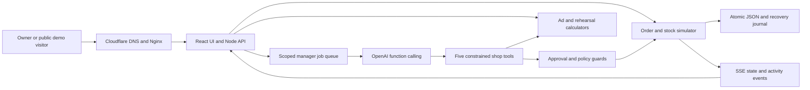

# ร้านเรา · AI Store Manager

ร้านเรา is a Thai-language manager for a simulated collectibles shop, bankzar. It connects decisions about advertising, stock, packaging, fulfillment and cash with the shop events that prove what actually happened.

## Problem

An owner selling online and over the counter can sell the last available collectible while a customer is waiting for a reply. Increasing advertising may consume boxes, labor and cash faster than it increases contribution. Looking at sales, chat and stock separately hides these consequences.

## Solution

Open ROBOT in the gallery and evaluate an additional ฿300 of advertising. The shop needs two incremental sales, 19 total units and enough packing capacity to recover that spend. Open SONIC to see how a physical sale changes channel stock and invalidates an earlier reply. An owner can review a proposed action, approve the exact option and inspect the message, documents or campaign state at the destination.

## Build direction

**Autonomous & Adaptive AI** is the primary direction. The owner grants authority by action and scope, including limits. Three consecutive unedited approvals surface a suggestion to increase autonomy. A reversed autonomous change or unsuccessful verification returns the policy to level one. The scorecard is computed from recorded decisions and receipts.

**Deep Domain AI** is the secondary direction. The shared calculators use order-level history, integer satang, separate POS and online demand, reserved packaging, packing capacity and settlement timing.

## Live demo link

Test on the development Mac at [127.0.0.1:4310](http://127.0.0.1:4310). The deployed app passed private-network checks at desktop and mobile widths. The public hostname [ranrao.ipongs.com](https://ranrao.ipongs.com) currently serves the proxy default and awaits activation of the staged Nginx site. [Verification details](docs/VERIFICATION.md) The app runs on a dedicated Node container behind the team's Nginx proxy. The public shop is shared. Its reset archives the current run and starts a fresh one for all visitors.

Use the [six-minute walkthrough](docs/DEMO.md) or select **เริ่มเดโม** in the app.

## How to run

Use Node 24 LTS and npm. The runtime requires Node 22.12 or newer.

```sh
git clone --branch hackathon/ranrao-node https://github.com/pakornc2534/regional-codex-hackathon.git
cd regional-codex-hackathon
npm ci
cp .env.example .env
npm run dev
```

Open [the local shop](http://127.0.0.1:4310). Vite forwards API and SSE traffic to port 4311. Production uses `npm run build` followed by `npm start` and serves the entire app from port 4310. Set `DATA_DIR` to a separate directory for each shop. The first launch automatically creates the seed.

For the two-machine deployment, set `SHOP_BIND_ADDRESS` to the application host's private IP, `TRUSTED_PROXY_IP` to the proxy host's private IP, `PUBLIC_ORIGIN=https://ranrao.ipongs.com`, and `PUBLIC_DEMO_ENABLED=true` in the application's private `.env`. On the app host run the following from the checkout.

```sh
docker compose --env-file .env -f deploy/compose.yml -p ranrao up -d --build
```

The named volume preserves the shop through container restarts and redeployments. On the proxy, render `deploy/ranrao.nginx.conf.template` with the TLS certificate path, its key path and the application upstream. Validate with `nginx -t` before reloading. The public DNS record is proxied by Cloudflare. Refresh the trusted edge ranges against [Cloudflare's published list](https://www.cloudflare.com/ips/).

## Architecture



The gallery and the 2D view open the same workspaces. Reading context maps to the product shelves, preparation reads and actions to the picking queue, plan and rehearsal calculations to the wall dashboard, and general proposals, replies and ad changes to the manager's computer. The avatar reflects recorded server activity. It shows a check only for a verified result.

## AI and simulated-data status

Set `OPENAI_API_KEY` on the Node service. The configured default is `gpt-4.1-mini`; `OPENAI_MODEL` can name another tool-capable model available to the team. The UI reports connection state, observed service errors, quotas and retries. A missing key leaves shop transactions, planning, rehearsals and daily briefs available. `DEMO_AI_ENABLED=false` stops model calls. `AI_DAILY_CAP` counts actual model requests by Thai calendar date across demo resets. Public origin checks, payload limits, per-IP and global request limits apply on the shared demo.

All accounts, orders, fees, stock, shipping deadlines and settlements are simulated. The demo starts on 2 October 2026 at 06:50 Bangkok time. Advancing the clock through 07:00 produces the day's brief. A customer reply case receives only the relevant customer's conversation and orders, product availability and public price. Private store memory is available in owner rooms.

## How Codex was used

Codex reconciled the original formulas against generated orders, implemented the simulator and two-channel inventory, built the component-based interface and primitive gallery, and checked the resulting behavior with Vitest, Chromium and deployed API reads. Review findings led to a common three-hour risk horizon and an explicit owner decision for partially sold-out multi-variant campaigns. [Milestone log](docs/CODEX_LOG.md)

## What was built during the hackathon

This implementation was written on the `hackathon/ranrao-node` branch from the repository's initial README. It includes the Node/OpenAI bridge, persistent shop, 3D and 2D gallery, five manager tools, public demo controls, ad planner, rehearsal, briefs, Docker deployment and tests. Other contributors added a different implementation to `main` during the event. The submission source for this build is [the Node branch](https://github.com/pakornc2534/regional-codex-hackathon/tree/hackathon/ranrao-node).

## Declarations

The product concept and build specification predate this implementation. The reviewed specification is included in [docs/SPEC.md](docs/SPEC.md). The authored application and gallery geometry on this branch were created from the specification. shadcn/ui components were generated with its official CLI. Main libraries include React, TypeScript, Vite, Hono, Tailwind CSS, shadcn/ui, Radix UI, Lucide, TanStack Query, Zustand, Three.js, React Three Fiber, Drei, Recharts, Zod, OpenAI's Node SDK, p-queue, write-file-atomic, Vitest and Playwright. The fonts are self-hosted Noto Sans Thai and Geist. [Direct dependencies](package.json) · [Complete resolved dependency tree](package-lock.json)

**TODO(team)** Confirm earlier personal or open-source project links, if applicable, and include them in the submission form. The team's final declaration and form submission are separate from the app deployment.

## Limitations

The forecasts depend on the owner's assumptions and apply only to the simulated shop. Each generated forecast order contains one selling unit. An existing multi-unit order remains one parcel. The app uses one service instance and a writable data volume. Shared visitors can affect one another's run. The backend rejects stale work and keeps receipts available for retry. Flash sales, vouchers, processing returns, investment planning and real Shopee connections are outside this build.

```sh
npm run typecheck
npm test
npm run build
npx playwright install chromium
npm run test:e2e
# Use a configured real key for an isolated live-model check
npm run test:live
```

For an installed Google Chrome, use `PW_CHANNEL=chrome npm run test:e2e`. See [verification evidence](docs/VERIFICATION.md) for which paths used an upstream fixture and which reached the model provider.
