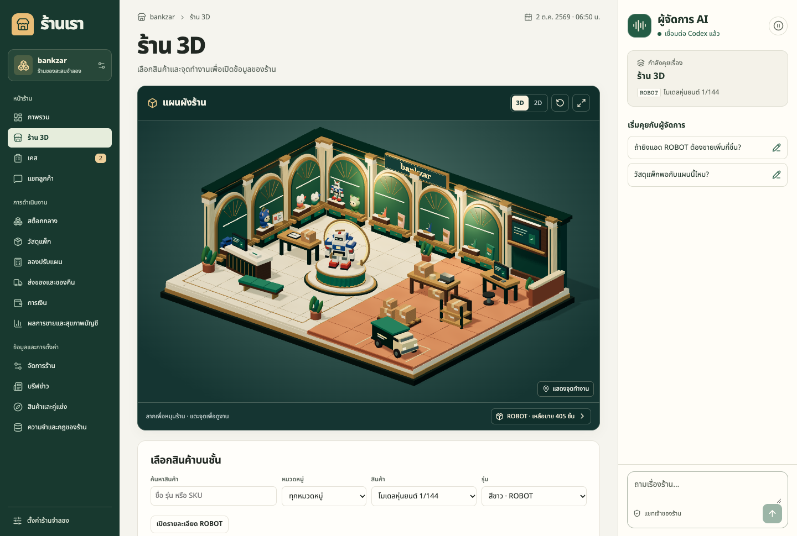
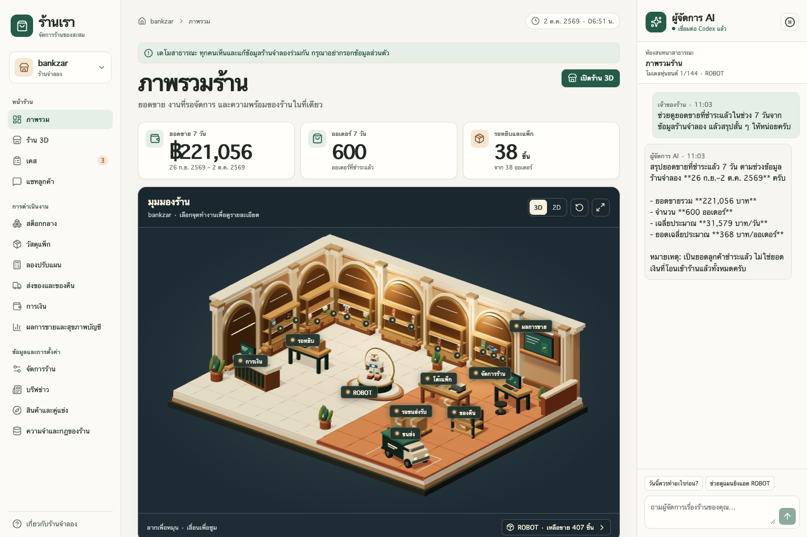

# Verification

## Local fixture and real model

The seeded shop has 2,658 orders. The 2,657 paid orders total ฿974,414. The seven-day reporting window contains 600 paid orders and ฿221,056. The model overview sampled 50 detail rows and reported 2,608 omitted while preserving whole-shop totals. The initial 1-day ROBOT plan returned 17 baseline units, 19 supported units, two additional units, 244 material sets, 25 preparation slots and ฿29,700 minimum planning cash.

A real logged-in Codex app-server processed the Sonic customer case on an isolated local API. The manager checked that physical stock was 2, reserved stock 1 and available stock 1. It saved an AI proposal. The test selected that option as owner, read back the target conversation and matched the exact approved text to the single newly delivered message.

The automated suite covers immutable previews, duplicate commands, approvals and cross-case scope, reserve/pack/collect/POS and material receipts, synchronization failure, returns, daily brief/mail delivery, current-run persistence, payload limits and stale or unauthorized relay requests. The transport tests round-trip a synthetic 30,000-record snapshot and reject a corrupt gzip envelope and an expansion beyond the permitted size.

## Reproduce

Run `npm test`, `npm run typecheck` and `npm run build`. For the genuine manager cycle, start the API with a fresh temporary DATA_DIR and run `TEST_ORIGIN=http://127.0.0.1:4310 node scripts/check-manager.mjs`. This sends one message in that disposable simulated world. For an informational model question only, add `READ_ONLY=1`.

The fake inbox and carrier events do not validate any actual Shopee or email service. Figures depend on the current shared demo state. For reproducible seed values, use an isolated local shop.

## Browser, deployment and recovery checks on 21 November 2026

- 23 automated tests passed, including a real local API subprocess whose response was deliberately lost after a POS sale. The relay recovered the original verified receipt and counted one additional order.
- Chrome rendered the rotatable scene and all operational areas. The product dialog opened a second advertising dialog. Escape closed only the top one and returned focus. ROBOT results showed 19 units total and preparation capacity 25. The desktop and 390/360 px mobile layouts had no document overflow in the tested views.
- In a disposable shop the browser picked a fixture response and verified the exact content in the customer inbox, placed a two-unit ROBOT order, generated its documents, packed it, confirmed collection, and received supplies.
- A browser session on the publicly deployed Site submitted an owner question to the shared demo, received a genuine model response, and found it displayed in the chat. The response reported ฿221,056 across 600 paid orders for the seven-day period. No real store was involved.
- The account-health report, sample news, simulated carrier and simulated email are fixtures. Live web-research quality depends on the connected account and its search service. The acceptance checks above did not validate live competitor coverage or any actual seller offer.

Additional checks: [domain scenarios](domain-verification.md). Run the destructive browser test only on a disposable local data directory using SHOP_UI_TEST_URL and scripts/check-ui.mjs. For the read-only layout test use TEST_ORIGIN and scripts/check-plan-layout.mjs.
